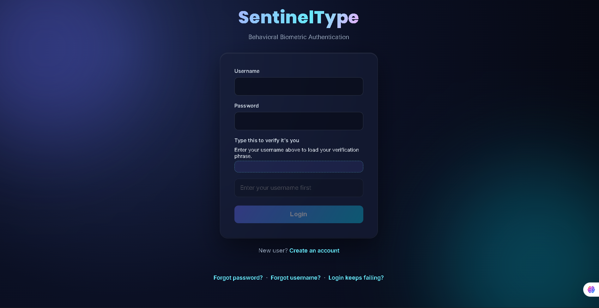
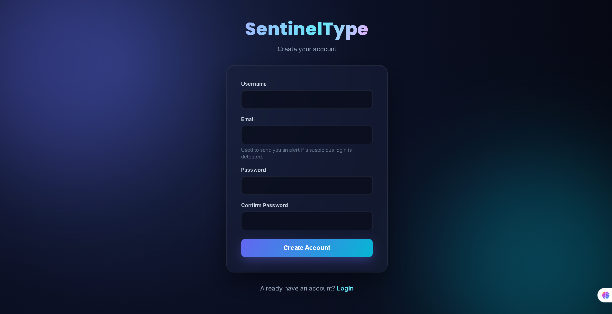
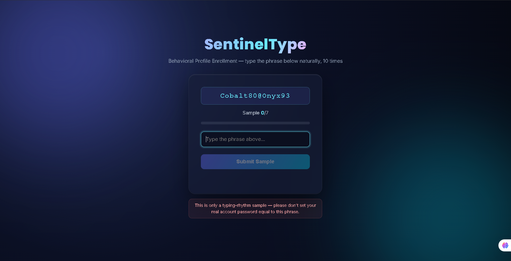
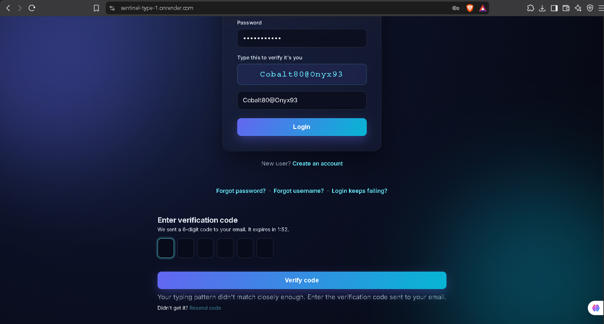
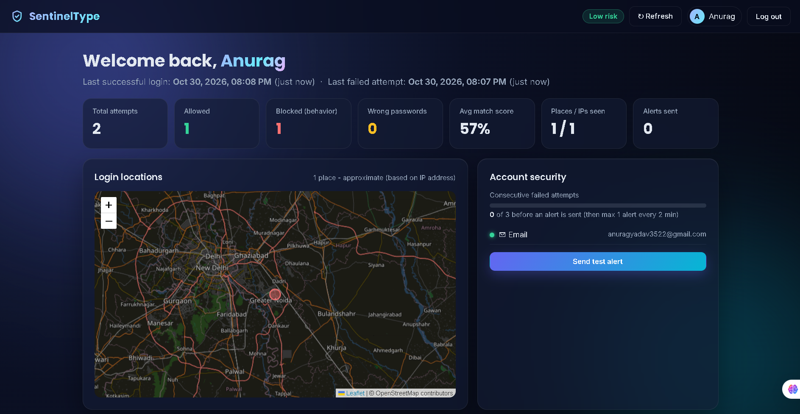
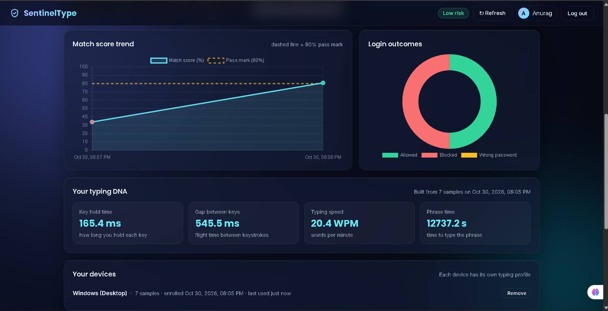
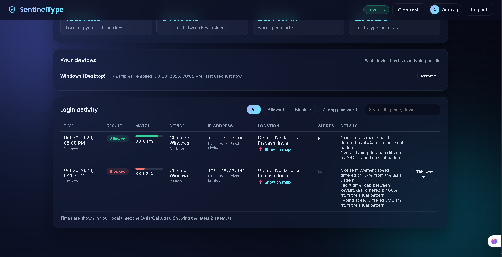
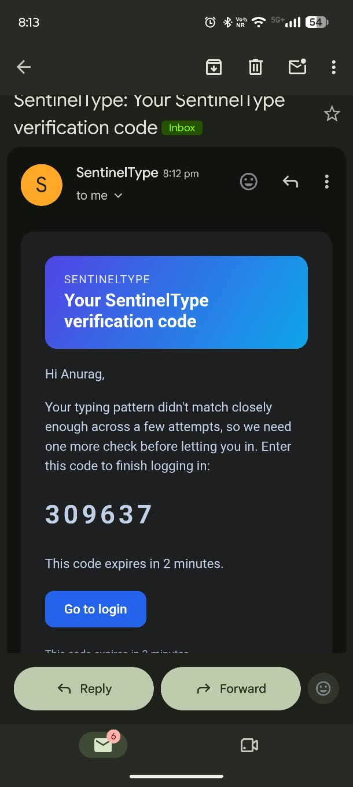
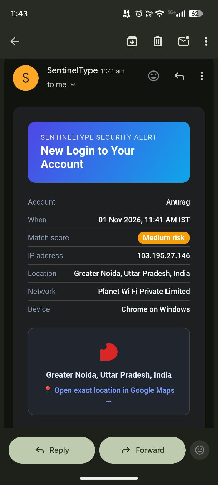

# SentinelType

### Behavioural Biometric Authentication & Intelligent Threat Detection System

**Beyond passwords. Beyond traditional verification. An additional layer of behavioural security.**

SentinelType is a behavioural biometric authentication system developed as a B.Tech Computer Science and Engineering mini-project. It enhances conventional password-based authentication by analysing how a user types and interacts with the system.

Instead of relying only on credentials, SentinelType builds a behavioural profile from a user's keystroke dynamics and mouse interaction patterns. During subsequent login attempts, it compares the new behaviour against the enrolled profile and evaluates whether the activity appears consistent with the genuine user.

The system combines machine learning, statistical behavioural analysis, and contextual login signals to support risk-based authentication decisions.

> **Project Status:** Academic Prototype  
> **Domain:** Cybersecurity | Machine Learning | Behavioural Biometrics

---

## Table of Contents

- [The Problem](#the-problem)
- [What Makes SentinelType Different](#what-makes-sentineltype-different)
- [How SentinelType Works](#how-sentineltype-works)
- [Core Features](#core-features)
- [Application Screenshots](#application-screenshots)
- [Behavioural Analysis](#behavioural-analysis)
- [Risk Decision Engine](#risk-decision-engine)
- [Technology Stack](#technology-stack)
- [Project Structure](#project-structure)
- [Installation and Setup](#installation-and-setup)
- [Model Evaluation](#model-evaluation)
- [Security and Limitations](#security-and-limitations)
- [Future Scope](#future-scope)
- [Author](#author)

---

## The Problem

Traditional authentication systems primarily verify a user's identity through credentials such as passwords, PINs, or one-time passwords.

Two-step verification and Multi-Factor Authentication (MFA) already provide important protection by requiring an additional verification factor. However, these mechanisms do not continuously analyse whether the person interacting with an account behaves like its legitimate owner.

For example:

- A password may be stolen through phishing or exposed in a data breach.
- An attacker may obtain access to an additional verification factor.
- A compromised session may remain active after the initial authentication.
- A legitimate user's account may be accessed from an unfamiliar device or environment.

This creates an opportunity for an additional security signal that evaluates the user's interaction behaviour.

## What Makes SentinelType Different?

SentinelType explores **behavioural biometrics as an additional layer of authentication**.

Every person develops a relatively distinctive way of typing and interacting with a keyboard and mouse. These patterns can be analysed to create a behavioural reference profile.

SentinelType uses this concept to evaluate login attempts after password verification.

### Traditional Two-Step Verification vs SentinelType

| Traditional Two-Step Verification | SentinelType |
|---|---|
| Verifies a password and an additional factor such as OTP | Analyses password and behavioural consistency |
| OTP verifies possession or access to a registered channel | Typing and mouse patterns provide behavioural signals |
| Usually focuses on identity verification at login | Evaluates whether current interaction resembles the enrolled profile |
| Does not inherently analyse typing rhythm | Uses keystroke dynamics and mouse interaction features |
| Additional verification depends on the configured authentication flow | Can trigger additional verification when behavioural confidence is insufficient |

**Important:** SentinelType does not replace Two-Step Verification or MFA. Its purpose is to complement existing authentication methods with an additional behavioural risk assessment layer.

From a security-engineering perspective, even if an attacker knows a user's password, their typing rhythm and interaction patterns may differ from the enrolled profile. SentinelType can use these differences as a signal to flag suspicious activity and request additional verification.

Behavioural biometrics are not perfect proof of identity, but they can make unauthorized access more difficult when combined with established security controls.

---

## How SentinelType Works

The authentication process is divided into the following stages.

### 1. User Registration

A new user creates an account by providing a username, email address, and password.

Passwords are stored using password hashing rather than plain-text storage.

### 2. Email Verification

The system sends an email verification link to confirm ownership of the registered email address.

### 3. Behavioural Enrollment

The user is presented with a predefined challenge phrase and asked to type it repeatedly.

During enrollment, the application captures keyboard timing and mouse interaction information to build a reference behavioural profile.

### 4. Behavioural Feature Extraction

The collected interaction data is converted into measurable features, such as:

- Key dwell time
- Key flight time
- Typing duration
- Typing speed
- Mouse movement speed
- Mouse click interval

### 5. Machine Learning Model

A per-user Isolation Forest model is trained using the enrolled behavioural samples.

The trained model is saved for use during future authentication attempts.

### 6. Login Verification

During login, the system first validates the password. If the password is correct, the user is asked to type the challenge phrase again.

The new behavioural sample is compared with the stored profile.

### 7. Risk Assessment

The machine-learning result and statistical comparison are combined by the Decision Engine to produce a behavioural match score.

Contextual information, such as IP address, approximate location, device, browser, and login time, is also recorded for security monitoring.

### 8. Authentication Decision

Depending on the configured rules and verification result, the system can:

- Allow the login
- Require additional verification
- Block the login attempt

### 9. Security Monitoring

Authentication events are stored in login history. Email notifications and account security features help users review and respond to suspicious activity.

---

## Core Features

### Authentication and Account Management

- User registration and login
- Password hashing
- Email address verification
- Forgot password functionality
- Secure password reset through email links
- Forgot username recovery
- Typing-profile reset and recovery

### Behavioural Biometrics

- Fixed challenge-phrase enrollment
- Keystroke dynamics collection
- Dwell time and flight time analysis
- Typing duration and words-per-minute calculation
- Mouse movement speed analysis
- Mouse click interval analysis
- User-specific behavioural profiles

### Machine Learning and Risk Analysis

- Per-user Isolation Forest anomaly detection
- Statistical behavioural comparison
- Combined behavioural match scoring
- Risk-based authentication decisions
- Human-readable explanations for behavioural differences

### Additional Security

- Email OTP verification
- Login security alerts
- Configurable failed-attempt alerting
- Resend-code controls and OTP expiry
- Trusted-device functionality
- Device-specific behavioural profiles
- Approximate IP-based location detection

### Security Dashboard

- Login summary statistics
- Allowed and blocked login records
- Wrong-password attempt tracking
- Match-score trend chart
- Login outcome chart
- Login location map
- Device information
- Searchable and filterable login activity

---

## Application Screenshots

The following screenshots demonstrate the implemented authentication workflow and security dashboard.

### 1. Login Interface



### 2. User Registration



### 3. Behavioural Enrollment



### 4. Email OTP Verification Interface



### 5. Security Dashboard



### 6. Behavioural Analytics



### 7. Device Management and Login Activity



### 8. Email OTP Notification



### 9. New Login Security Alert



### 10. Email Address Verification


---

## Behavioural Analysis

SentinelType analyses behavioural characteristics collected during user interaction.

### Keystroke Dynamics

**Dwell Time:** Measures how long a key remains pressed.

**Flight Time:** Measures the time interval between consecutive keystrokes.

**Typing Duration:** Measures the time required to enter the complete challenge phrase.

**Typing Speed:** Estimates typing speed in words per minute (WPM).

### Mouse Dynamics

The system also captures mouse-related behavioural signals, including:

- Average mouse movement speed
- Average click interval

These features are used in the statistical comparison and human-readable explanation process. Mouse-related features are not all necessarily part of the Isolation Forest model input.

### Isolation Forest

SentinelType uses the Isolation Forest algorithm from scikit-learn for anomaly detection.

The model learns the characteristics of the enrolled user's behavioural samples and evaluates new samples for unusual patterns.

A separate model is maintained for each user.

### Statistical Comparison

The statistical verification component compares current behavioural features against the user's stored reference profile.

It calculates differences in relevant features and generates explanations when significant deviations are detected.

---

## Risk Decision Engine

The Decision Engine combines the machine-learning anomaly score and statistical comparison score into a unified behavioural match score.

The result is evaluated using configured decision thresholds.

The system supports three possible outcomes:

| Outcome | Description |
|---|---|
| Allow | Behavioural verification satisfies the configured acceptance criteria |
| Challenge | Additional verification is required |
| Block | The login attempt does not satisfy the configured security criteria |

The thresholds are configurable and may be adjusted during evaluation.

**Note:** A match score or decision threshold is not the same as measured model accuracy. Actual FAR, FRR, and EER should be evaluated separately.

---

## Technology Stack

| Layer | Technologies |
|---|---|
| Programming Language | Python |
| Backend Framework | Flask |
| Frontend | HTML, CSS, JavaScript |
| Database | SQLite |
| ORM | Flask-SQLAlchemy |
| Database Migrations | Flask-Migrate, Alembic |
| Machine Learning | scikit-learn |
| Anomaly Detection | Isolation Forest |
| Model Persistence | Joblib |
| Email Service | Gmail SMTP |
| IP Geolocation | ip-api.com |
| Data Visualization | Chart.js |
| Interactive Maps | Leaflet, OpenStreetMap |
| Version Control | Git and GitHub |
| Deployment Configuration | Procfile |

---

## Project Structure

The following structure represents the main application files and directories.

```text
sentinel-type/
│
├── __pycache__/
│
├── assets/
│   └── screenshots/
│       ├── 01-login.png
│       ├── 02-registration.png
│       ├── 03-enrollment.png
│       ├── 04-otp-verification.png
│       ├── 05-dashboard-overview.png
│       ├── 06-dashboard-analytics.png
│       ├── 07-login-activity.png
│       ├── 08-otp-email.png
│       ├── 09-login-alert-email.png
│       └── 10-email-verification.png
│
├── evaluation_output/
│   ├── far_frr_curve.png
│   └── report.md
│
├── instance/
│   ├── ml_models/
│   └── sentinel_type.db
│
├── migrations/
│   ├── versions/
│   ├── alembic.ini
│   ├── env.py
│   └── script.py.mako
│
├── models/
│   ├── __init__.py
│   ├── behavioral_profile.py
│   ├── behavioral_sample.py
│   ├── login_history.py
│   └── user.py
│
├── scripts/
│   ├── evaluate_model.py
│   ├── reset_database.py
│   └── set_password.py
│
├── services/
│   ├── __init__.py
│   ├── alerts.py
│   ├── behavioral_verification.py
│   ├── decision_engine.py
│   ├── email_alert.py
│   ├── geolocation.py
│   ├── ml_model.py
│   ├── sms_alert.py
│   └── utils.py
│
├── static/
│   ├── css/
│   │   ├── dashboard.css
│   │   └── style.css
│   │
│   └── js/
│       ├── dashboard.js
│       ├── enroll.js
│       ├── forgot_username.js
│       ├── register.js
│       └── script.js
│
├── templates/
│   ├── dashboard.html
│   ├── enroll.html
│   ├── forgot_password.html
│   ├── forgot_username.html
│   ├── login.html
│   ├── register.html
│   ├── reset_password.html
│   └── reset_profile.html
│
├── .env.example
├── .gitignore
├── app.py
├── dashboard_routes.py
├── extensions.py
├── Procfile
├── README.md
└── requirements.txt
```

**Note:** `venv/`, `.env`, `__pycache__/`, and generated runtime files are local or environment-specific and should not be committed as part of the source repository.

---

## Installation and Setup

### Prerequisites

- Python 3.10 or later
- Git
- pip

### 1. Clone the Repository

```bash
git clone https://github.com/gufrancse/sentinel-type.git

cd sentinel-type
```

### 2. Create a Virtual Environment

**Windows:**

```bash
python -m venv venv

venv\Scripts\activate
```

**Linux / macOS:**

```bash
python3 -m venv venv

source venv/bin/activate
```

### 3. Install Dependencies

```bash
pip install -r requirements.txt
```

### 4. Configure Environment Variables

Create a `.env` file in the project root using `.env.example` as a reference.

Configure the required environment variables, including:

- Application secret key
- Gmail address for email notifications
- Gmail App Password
- Public base URL, where required for email links

Do not upload real credentials or secret values to GitHub.

### 5. Run the Application

```bash
python app.py
```

Open the local URL displayed in the terminal.

The application uses SQLite for local database storage and the project includes database migration support.

---

## Model Evaluation

SentinelType includes an evaluation script for examining behavioural authentication performance.

Run the evaluation script:

```bash
python scripts/evaluate_model.py
```

The evaluation process simulates genuine-user and impostor login trials and examines standard biometric evaluation metrics.

### Evaluation Metrics

| Metric | Description |
|---|---|
| FAR | False Acceptance Rate |
| FRR | False Rejection Rate |
| EER | Equal Error Rate |

- **FAR:** Measures the proportion of impostor attempts incorrectly accepted.
- **FRR:** Measures the proportion of genuine-user attempts incorrectly rejected.
- **EER:** Represents the point where FAR and FRR are equal.

The generated evaluation outputs are stored in the `evaluation_output/` directory.

These results are based on simulated evaluation trials and should not be interpreted as proof of production-level accuracy or performance across a large real-user population.

---

## Security Considerations and Limitations

SentinelType demonstrates behavioural biometrics as an additional authentication mechanism. However, several limitations must be considered.

### 1. Limited Enrollment Samples

A small number of behavioural samples may not capture all natural variations in a user's typing behaviour. A production system would benefit from larger datasets and periodic profile updates.

### 2. Behavioural Variability

Typing behaviour can change due to fatigue, stress, keyboard layout, device differences, and environmental conditions. This may result in false acceptance or false rejection.

### 3. Client-Side Data Manipulation

Keystroke and mouse timing information is collected in the browser and transmitted to the backend. A production deployment would require stronger protection against manipulated client-side data.

### 4. Approximate Geolocation

The system uses a free IP-geolocation service to identify approximate geographical information. It may identify a nearby city or area rather than an exact physical location. It does not provide precise GPS tracking.

### 5. Model Evaluation Scope

The evaluation script uses simulated genuine-user and impostor trials. Further testing with a larger and more diverse real-user dataset is necessary.

### 6. Prototype Scope

SentinelType is a standalone academic prototype. It does not connect to or replace a real third-party authentication provider.

Behavioural verification should supplement established security mechanisms such as strong passwords and Multi-Factor Authentication rather than replace them.

---

## Future Scope

Potential improvements include:

- Larger and more diverse behavioural datasets
- More extensive real-user testing
- Continuous authentication during active sessions
- Adaptive behavioural profile updates
- Improved cross-device behavioural learning
- Stronger server-side validation of behavioural data
- Enhanced device intelligence and contextual risk analysis
- Better privacy controls and behavioural-data protection
- Integration with third-party authentication systems through secure APIs

---

## Why This Project Matters

Modern authentication systems already use passwords, OTPs, and multiple verification factors. SentinelType explores an additional question:

**Can a system use the way someone interacts with a device as another signal to assess whether a login attempt is genuine?**

By analysing typing rhythm and mouse interaction patterns, SentinelType demonstrates how behavioural biometrics can contribute to a more context-aware authentication process.

Its goal is not to replace existing security methods, but to explore an additional layer that may help identify suspicious activity even when an attacker has obtained valid login credentials.

---

## Author

**Gufran Ahmad**  
B.Tech – Computer Science and Engineering  
ITS Engineering College, Greater Noida

GitHub: [@gufrancse](https://github.com/gufrancse)

Project Repository: [SentinelType](https://github.com/gufrancse/sentinel-type)

---

*SentinelType — Exploring Behavioural Biometrics as an Additional Layer of Digital Security.*